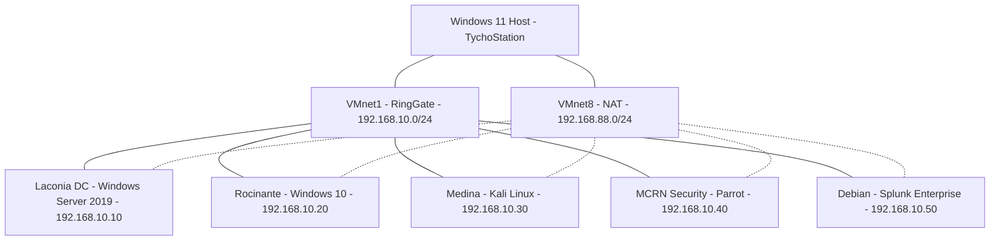

# Laconia Cybersecurity Lab

## Overview

Laconia is a virtual enterprise cybersecurity lab I designed and built using VMware Workstation to develop practical skills in networking, Windows Server administration, Active Directory security, and SIEM monitoring.

The environment simulates a small corporate network with Windows and Linux systems, centralized identity management, and Splunk Enterprise.

## Technologies

- **Virtualization:** VMware Workstation
- **Operating Systems:** Windows Server 2019, Windows 10, Debian, Kali Linux, Parrot Security OS
- **Identity & Access:** Active Directory, LDAP, Group Policy
- **Networking:** TCP/IP, DNS, NAT, host-only networking
- **Security Monitoring:** Splunk Enterprise 10.4.3
- **Tools:** Windows administration tools, Linux CLI, network troubleshooting utilities

## Network Architecture

The lab uses two VMware virtual networks:

- **VMnet1 (RingGate):** Host-only network, `192.168.10.0/24`
- **VMnet8:** NAT network, `192.168.88.0/24`

| Machine | Operating System | Internal IP | Role |
|---|---|---|---|
| Laconia DC | Windows Server 2019 | 192.168.10.10 | AD DS, DNS, Group Policy |
| Rocinante | Windows 10 | 192.168.10.20 | Domain-joined workstation |
| Medina | Kali Linux | 192.168.10.30 | Security testing |
| MCRN Security | Parrot Security OS | 192.168.10.40 | Security testing |
| Splunk Server | Debian Linux | 192.168.10.50 | Centralized log collection |

### Network Diagram

Solid lines represent the internal host-only network; dotted lines represent additional NAT connections.

## Active Directory Administration

Configured a Windows Server 2019 domain controller for the `laconia.local` domain.

Key implementations:

- Installed Active Directory Domain Services and DNS.
- Created Organizational Units, users, and security groups.
- Joined the Rocinante Windows 10 workstation to the domain.
- Configured and reviewed Group Policy Objects.
- Examined password complexity, password history, account lockout, and Kerberos policies.
- Verified DNS resolution and domain connectivity.

The organizational structure simulates departments within a fictional enterprise, including military operations, administration, and science.

## Security Monitoring — Splunk

Installed Splunk Enterprise 10.4.3 on a dedicated Debian Linux VM.

- **Server:** `192.168.10.50`
- **Receiving port:** TCP 9997
- **Purpose:** Centralized log collection, monitoring, and security investigation

Configured Splunk to receive forwarded data and verified network connectivity and data forwarding.

Planned improvements include collecting Windows Security Event Logs from Rocinante, investigating authentication events, and creating monitoring dashboards and alerts.

## Lab Screenshots

### Active Directory Organizational Units

### Group Policy Objects

### Password and Account Lockout Policies

### Windows 10 Domain Membership

Rocinante successfully joined the `laconia.local` domain.

### Splunk Data Receiving

Splunk Enterprise configured to receive forwarded data on TCP port 9997.

## Troubleshooting and Lessons Learned

- **DNS and domain connectivity:** Verified communication between the Windows client and domain controller using network connectivity tests and DNS queries.
- **Splunk startup:** Investigated a failed Splunk startup, checked installation status and directory permissions, and successfully started Splunk using its dedicated service account.
- **Security configuration:** Reviewed domain password and account lockout policies, identifying areas for future hardening, including increasing the minimum password length.

## Future Development

- Expand Windows event log collection and SIEM analysis.
- Develop practical SOC investigation exercises.
- Implement additional system hardening and security monitoring.
- Integrate the SÝN AI Security Agent for Active Directory queries and administration.
