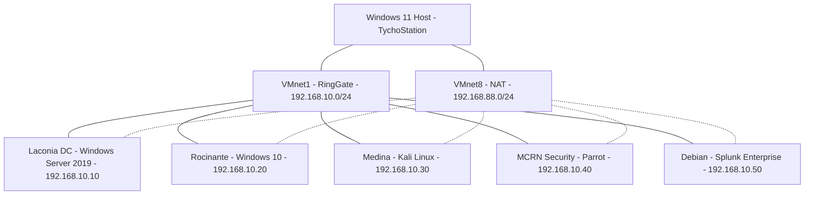
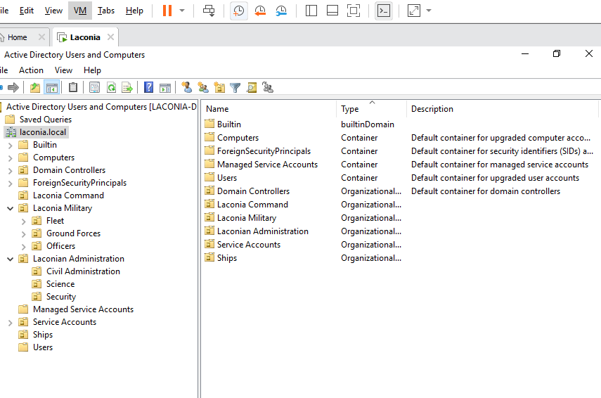
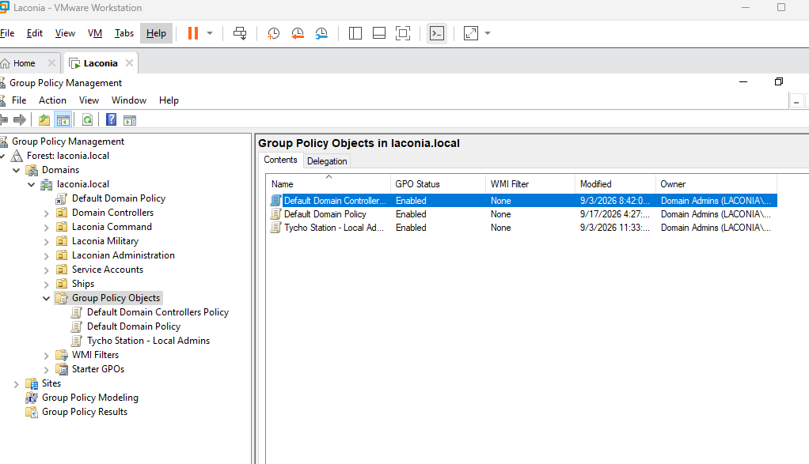
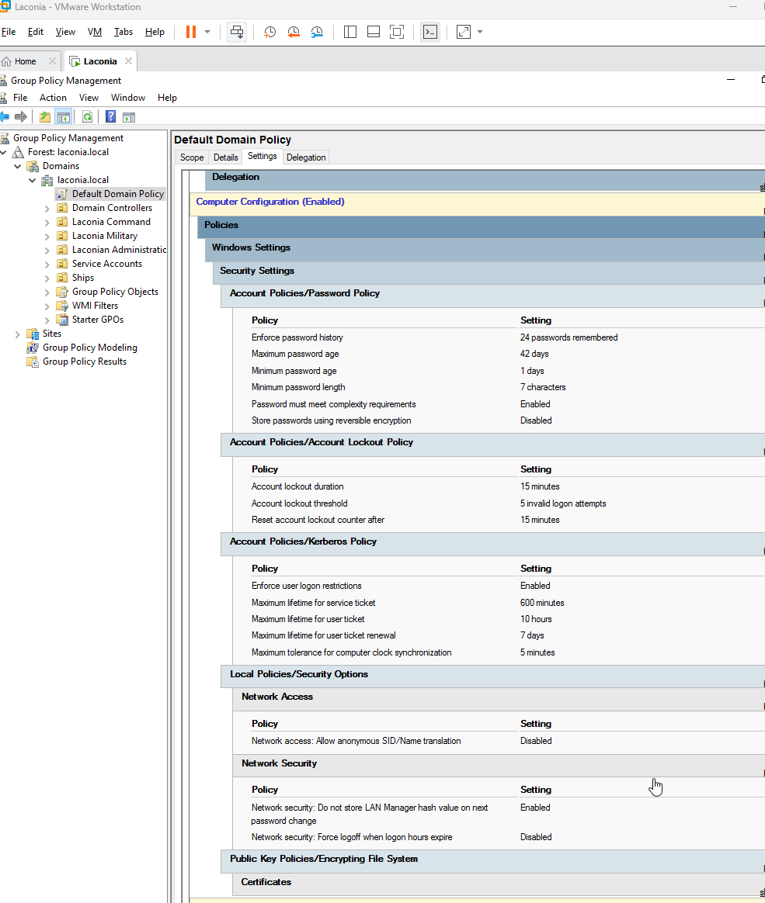
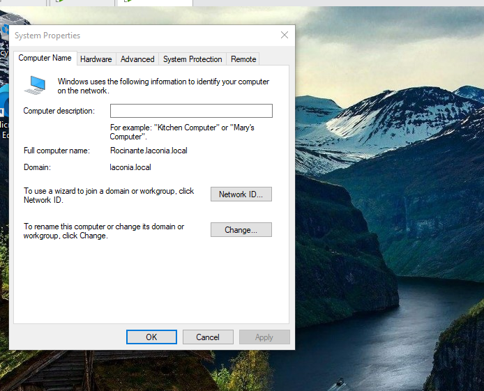
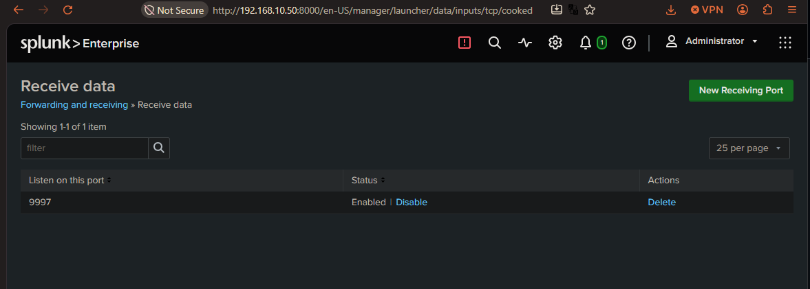

# Laconia Cybersecurity Lab

## Project Overview

Laconia is a virtual enterprise cybersecurity lab I designed and built to develop practical skills in system administration, networking, cybersecurity, and security monitoring.

The environment simulates a small corporate network using Windows Server, Windows 10, and multiple Linux systems connected through VMware Workstation.

The lab provides hands-on experience with Active Directory, DNS, Group Policy, network configuration, identity and access management, and Splunk SIEM.

## Technologies Used

- **Virtualization:** VMware Workstation
- **Operating Systems:** Windows Server 2019, Windows 10, Debian Linux, Kali Linux, Parrot Security OS
- **Identity Management:** Active Directory Domain Services (AD DS), LDAP, Group Policy
- **Networking:** TCP/IP, DNS, NAT, host-only networking
- **Security Monitoring:** Splunk Enterprise
- **Security Tools:** Linux command-line utilities and network troubleshooting tools

## Project Objectives

- Build and administer a realistic Windows domain environment.
- Configure and troubleshoot communication between Windows and Linux systems.
- Implement centralized identity and access management.
- Develop practical experience with security monitoring and log analysis.
- Use the environment for cybersecurity exercises and incident investigation.

## Network Architecture

The Laconia lab uses VMware Workstation with two virtual networks:

- **VMnet1 (Host-only / RingGate):** 192.168.10.0/24 — Internal communication between lab machines.
- **VMnet8 (NAT):** 192.168.88.0/24 — Provides external network connectivity through the host.

### Virtual Machines

| Machine | Operating System | Internal IP | Role |
|---|---|---|---|
| Laconia Domain Controller | Windows Server 2019 | 192.168.10.10 | Active Directory, DNS, Group Policy |
| Rocinante | Windows 10 | 192.168.10.20 | Domain-joined workstation |
| Medina | Kali Linux | 192.168.10.30 | Security testing |
| MCRN Security | Parrot Security OS | 192.168.10.40 | Security testing |
| Splunk Server | Debian Linux | 192.168.10.50 | Centralized log collection and analysis |

### Active Directory Configuration

- **Domain:** `laconia.local`
- **Domain Controller:** Windows Server 2019
- **Services:** Active Directory Domain Services, DNS, Group Policy
- **Configuration:** Organizational Units (OUs), user accounts, security groups, and domain-joined Windows workstation

## Security Monitoring — Splunk SIEM

I installed Splunk Enterprise on a dedicated Debian Linux virtual machine to develop practical skills in centralized log management, security monitoring, and incident investigation.

### Configuration

- **SIEM Platform:** Splunk Enterprise 10.4.3
- **Operating System:** Debian Linux
- **Internal IP Address:** `192.168.10.50`
- **Receiving Port:** TCP 9997

### Implementation

- Installed and configured Splunk Enterprise on Debian.
- Configured Splunk to receive forwarded data.
- Verified connectivity and data forwarding to the Splunk server.
- Established a foundation for collecting and analyzing security events from the lab environment.

### Next Steps

- Install Splunk Universal Forwarder on the Windows 10 workstation.
- Collect Windows Security Event Logs.
- Practice searching and investigating authentication events.
- Develop basic security monitoring dashboards and alerts.

  
## Network Architecture Diagram

This environment allows me to practice Windows domain administration, network troubleshooting, access management, and security monitoring in an isolated virtual lab.

## Active Directory Administration

I configured a Windows Server 2019 domain controller to practice enterprise identity management, authentication, and access control.

### Implemented Features

- Installed and configured Active Directory Domain Services (AD DS).
- Created the `laconia.local` domain.
- Configured DNS for domain name resolution.
- Joined a Windows 10 workstation (Rocinante) to the domain.
- Created and managed Organizational Units (OUs), user accounts, and security groups.
- Configured Group Policy and reviewed domain password policies.
- Verified domain connectivity using DNS queries and authentication-related network tests.

### Organizational Structure

The Active Directory environment includes organizational units representing departments within a fictional enterprise, including military operations, administration, and science.

This structure provides a practical environment for exploring centralized administration, identity and access management, and security policies.

### Skills Demonstrated

Active Directory administration, Windows Server, DNS troubleshooting, Group Policy, user and group management, and identity security.

## Lab Screenshots

### Active Directory — Organizational Units

The screenshot below shows the organizational structure configured in the Laconia Active Directory domain.

### Group Policy Objects

### Group Policy — Password and Account Lockout Security

Configured and reviewed domain security policies using Windows Server 2019 Group Policy Management.

The configuration includes password complexity requirements, password history, account lockout thresholds, and Kerberos authentication settings.

### Windows 10 — Active Directory Domain Membership

Rocinante, a Windows 10 workstation, successfully joined the `laconia.local` domain.

### Splunk Enterprise — Data Receiving

Splunk Enterprise 10.4.3 running on Debian Linux, configured to receive forwarded data on TCP port 9997.

